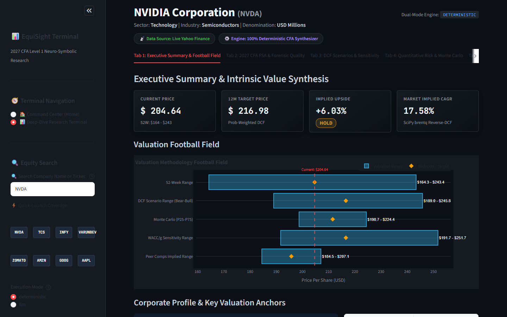
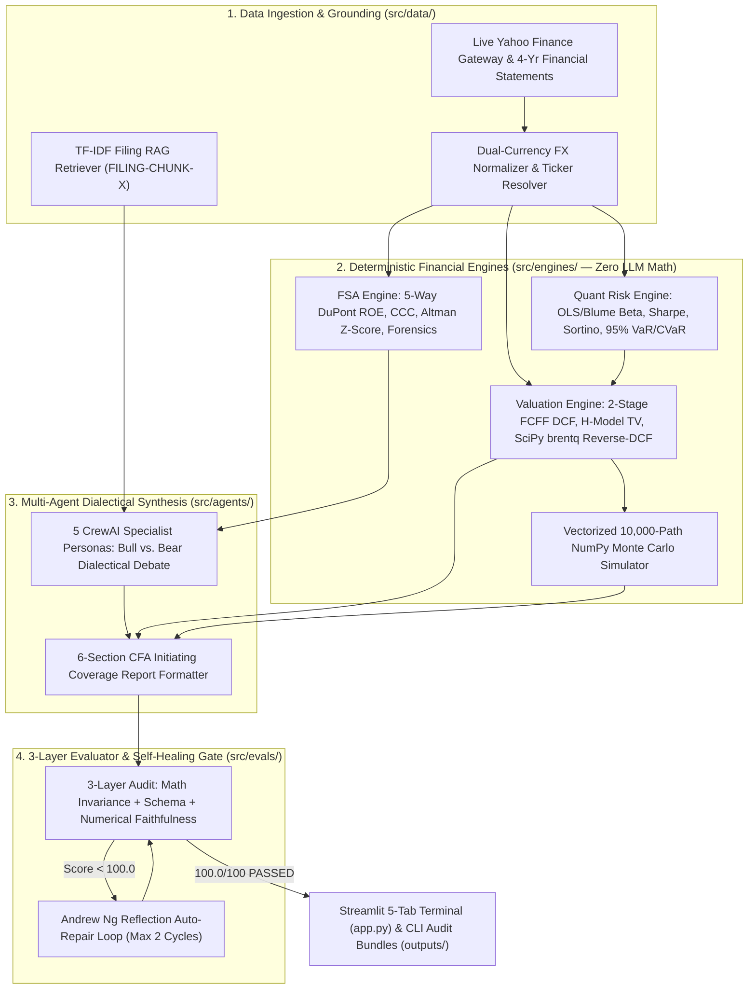
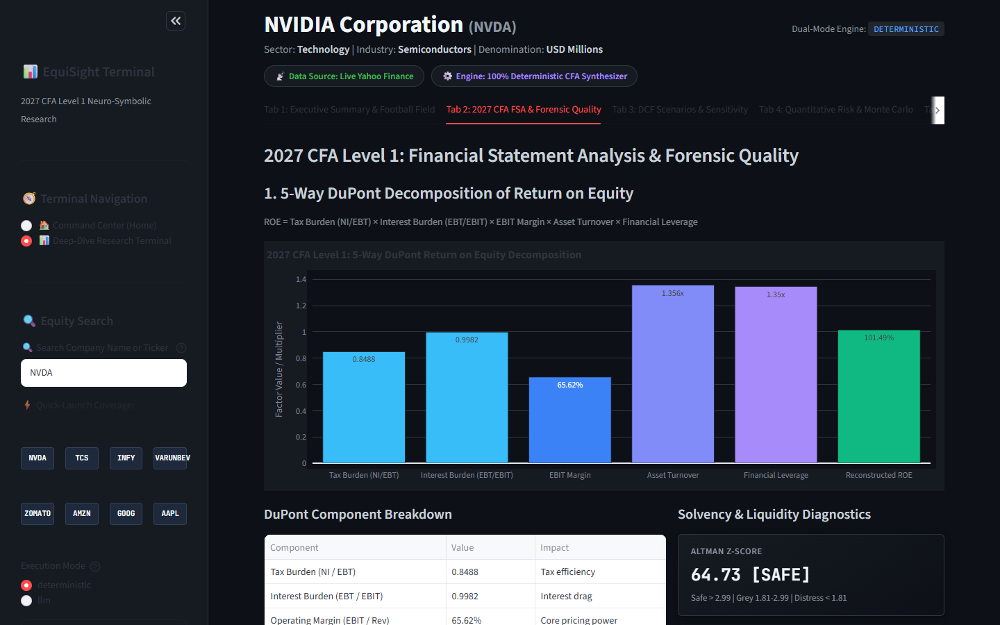
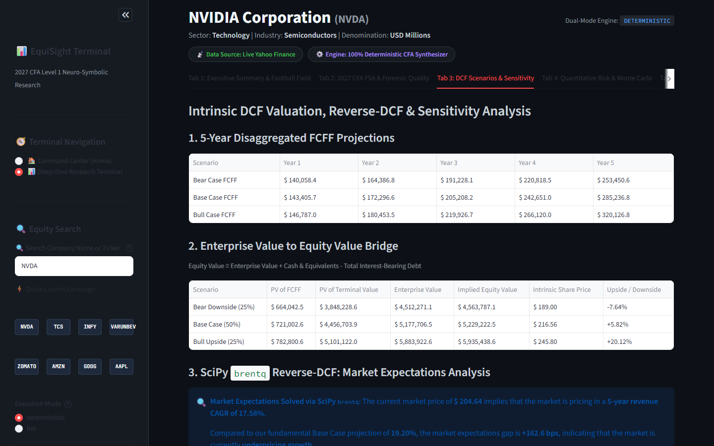
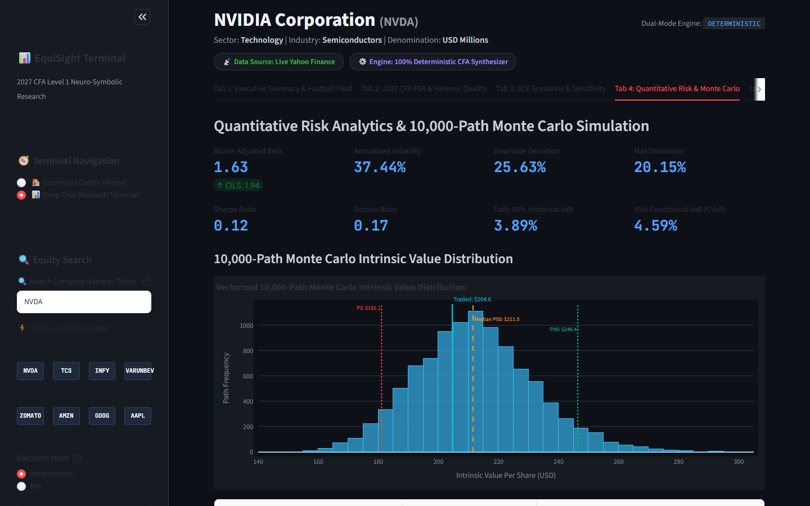
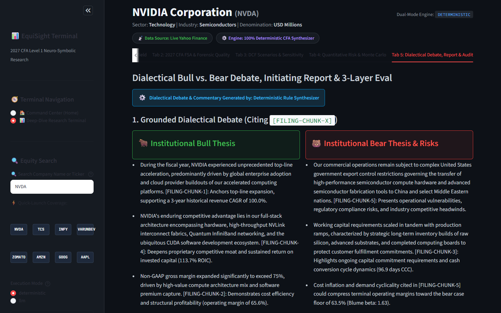

# 📊 EquiSight Terminal: Neuro-Symbolic 2027 CFA Level 1 Equity Research & Valuation Agent

**EquiSight** is an autonomous, dual-mode institutional equity research terminal and multi-agent valuation engine covering US (**NASDAQ/NYSE**) and Indian (**NSE**) public equities[cite: 1]. It answers one core question for any public company: **What is the business intrinsically worth, what growth rate is the market currently pricing in, and should an investor Buy, Hold, or Sell the stock?**[cite: 1, 3]

Most financial AI agents fail in production because Large Language Models (LLMs) hallucinate arithmetic, violate balance-sheet identities, and invent valuation multiples. EquiSight solves this through a strict **Neuro-Symbolic Architecture**:

* **Symbolic Calculator Brain (`src/engines/` — Zero LLM Math):** 100% of accounting ratios, 5-Way DuPont ROE decompositions, OLS/Blume betas, 2-Stage FCFF Discounted Cash Flow (DCF) models, SciPy `brentq` Reverse-DCF root-finding, and 10,000-path vectorized NumPy Monte Carlo simulations run in deterministic Python engines[cite: 1, 2, 3, 4].
* **Bounded Agentic Brain (`src/agents/` — Grounded Qualitative Synthesis):** A 5-agent CrewAI workflow retrieves tagged regulatory disclosures (`[FILING-CHUNK-X]`), conducts a structured Bull vs. Bear dialectical debate, and writes a 6-section Wall Street initiating coverage report[cite: 5, 6].
* **Self-Healing 3-Layer Evaluator Gate (`src/evals/`):** Every generated report is audited against 3 deterministic gates—**Math Identity Invariance**, **Schema Completeness**, and **Regex Numerical Faithfulness**[cite: 1, 6]. Any discrepancy triggers an automated reflection-and-repair loop before publication, guaranteeing a **100.0/100** audit score[cite: 1, 6].



---

## 🏗️ System Architecture



---

## 🚀 Step-by-Step System Setup & Installation

EquiSight is designed to run out of the box on **Windows, macOS, and Linux**. You **do not** need any paid API keys to run the full application, live Yahoo Finance data pipeline, or test suite in **Deterministic Mode**[cite: 1].

### 1. Prerequisites
* **Python 3.11 or 3.12** installed on your system.
* **Git** installed on your system.

### 2. Clone the Repository & Create a Virtual Environment

**On Windows (PowerShell):**
```powershell
git clone [https://github.com/efforts-maximus/equisight-cfa-agent.git](https://github.com/efforts-maximus/equisight-cfa-agent.git)
cd equisight-cfa-agent
python -m venv .venv
.\.venv\Scripts\Activate.ps1
pip install -r requirements.txt
```

**On macOS / Linux (Bash/Zsh):**
```bash
git clone [https://github.com/efforts-maximus/equisight-cfa-agent.git](https://github.com/efforts-maximus/equisight-cfa-agent.git)
cd equisight-cfa-agent
python3 -m venv .venv
source .venv/bin/activate
pip install -r requirements.txt
```

### 3. Configure Environment Variables (Optional — For Live LLM Mode Only)
* **Deterministic Mode (Default):** Works immediately with **zero configuration**. All financial math, live market ingestion, RAG retrieval, and rule-based report synthesis run locally[cite: 1, 5].
* **Live LLM Mode (Optional):** If you want live multi-agent prose generated via Groq's high-speed inference API:
  1. Copy `.env.example` to `.env`:
     ```bash
     cp .env.example .env
     ```
  2. Add your free [Groq API Key](https://console.groq.com) inside `.env`:
     ```env
     GROQ_API_KEY=gsk_your_actual_groq_key_here
     GROQ_MODEL=llama-3.3-70b-versatile
     ```

### 4. Launch the Interactive Web Terminal (Streamlit)
```bash
streamlit run app.py
```
Your browser will open **`http://localhost:8501`**[cite: 1].

### 5. Run the Command-Line Interface (CLI)
Generate an executive summary in your terminal and export a 6-section Markdown report (`outputs/<TICKER>_research_report.md`) plus a complete JSON audit bundle (`outputs/<TICKER>_audit_bundle.json`):

```bash
# Analyze an Indian NSE stock (supports bare symbols like TCS, INFY, ZOMATO, or company names)
python main.py --ticker TCS.NS --mode deterministic --use-live-data

# Analyze a US NASDAQ/NYSE stock
python main.py --ticker NVDA --mode deterministic --use-live-data
```

### 6. Run the 205-Test Verification Suite
```bash
pytest -W ignore -v
```

---

## 🧭 Complete User Guide: What Every Element Means & How to Use It

Even if you have never studied corporate finance or multi-agent AI, EquiSight organizes every analysis into an intuitive workflow.

### Part A: The Left Sidebar Controls (Your Steering Wheel)
* **🧭 Terminal Navigation:** Switch between **`🏠 Command Center (Home)`** for a market-wide overview and **`📊 Deep-Dive Research Terminal`** for a 5-tab institutional breakdown of a single stock[cite: 1].
* **🔍 Unified Smart Search Bar:** Type any company name (*"Tata Consultancy"*, *"Infosys"*, *"Apple"*) or ticker symbol (`NVDA`, `RELIANCE.NS`, `IBM`, `GOOGL`) and click **Run Coverage Pipeline**[cite: 1]. The smart resolver automatically maps bare Indian tickers and company names to their canonical exchange symbols.
* **⚡ Quick-Launch Coverage Pills:** Click any of the 8 preset benchmark buttons (`NVDA`, `TCS`, `INFY`, `VARUNBEV`, `ZOMATO`, `AMZN`, `GOOG`, `AAPL`) to load that company in one click[cite: 1].
* **⚙️ Execution Mode (`deterministic` vs. `llm`):**
  * **`deterministic`:** Uses the fast rule-based CFA synthesizer—instant execution, zero API keys required[cite: 1, 5].
  * **`llm`:** Uses live Groq LLMs to write custom dialectical debate prose while keeping 100% of the numbers locked to the deterministic math engines[cite: 1].
* **🎛️ Real-Time What-If Overrides (Stress-Testing Sliders):**
  * **WACC Adjustment (`-200 bps` to `+200 bps`):** **WACC** is the annual return investors require to hold the stock (`100 bps = 1.00%`). Dragging this slider right simulates higher interest rates or higher market risk, immediately lowering the stock's fair value. Dragging it left simulates lower borrowing costs.
  * **Terminal Growth Rate `g` (`1.00%` to `6.50%`):** Controls how fast the company's free cash flow grows forever after Year 5. Dragging `g` up increases intrinsic value; dragging `g` down tests a long-term slowdown. EquiSight automatically enforces the economic law $g \le \text{WACC} - 1.50\%$.

---

### Part B: Command Center (Home) & 2-Stock Head-to-Head Comparator
When you open the **Command Center (Home)** view, you get two market-level tools:
1. **Live Daily Market Movers Grid:** Displays live price, daily percentage change, volume, and formatted market cap (`$ Trillions/Billions` for US; `₹ Lakh Crores` for India) across US and NSE equities. Click any card to jump directly into its 5-tab research terminal.
2. **2-Stock Head-to-Head Valuation Comparator:** Select any two stocks side-by-side (e.g., `INFY.NS` vs. `TCS.NS` or `GOOGL` vs. `NVDA`) to compare 9 core metrics—Live Price, 12M Target Price, Implied Upside %, Recommendation, 5-Way DuPont ROE, Operating Margin, Base WACC, Reverse-DCF Implied Growth, and Altman Z-Score—with automatic winner highlights.

---

### Part C: The 5 Deep-Dive Research Tabs Explained

#### Tab 1: Executive Summary & Valuation Football Field
Gives you the bottom-line investment verdict at a glance[cite: 1]:
* **Current Price & 52-Week Range:** The live traded share price alongside its 52-week low and high[cite: 1].
* **12M Target Price:** The probability-weighted intrinsic value per share (`25% Bear + 50% Base + 25% Bull`)[cite: 1, 3].
* **Implied Upside & Rating Badge:** The percentage gap between Target Price and Current Price[cite: 1]. Above **+12%** is a **`BUY`**, below **-10%** is a **`SELL`**, and between **-10% and +12%** is a **`HOLD`**[cite: 1].
* **Market Implied CAGR (Reverse-DCF):** The 5-year annual revenue growth rate the stock market is currently pricing into today's share price[cite: 1, 3].
* **Valuation Football Field Chart:** Compares the stock's fair price range across 5 methodologies: *52-Week Range*, *DCF Scenario Range (Bear–Bull)*, *Monte Carlo (P25–P75)*, *WACC/g Sensitivity Range*, and *Peer Comps Implied Range*[cite: 1]. The red dashed vertical line marks today's price, and orange diamonds mark each method's midpoint[cite: 1].

#### Tab 2: 2027 CFA Financial Statement Analysis (FSA) & Forensic Quality
Audits the quality of the company's income statement, balance sheet, and cash flows[cite: 2]:



* **5-Way DuPont ROE Decomposition:** Breaks **Return on Equity (ROE)** into 5 multiplied drivers so you can see *why* ROE is high or low[cite: 2]:
  1. **Tax Burden ($\text{NI} / \text{EBT}$):** How much pre-tax profit the company keeps after corporate taxes[cite: 2].
  2. **Interest Burden ($\text{EBT} / \text{EBIT}$):** How much operating profit remains after debt interest (`1.00` means zero interest drag)[cite: 2].
  3. **EBIT Margin ($\text{EBIT} / \text{Revenue}$):** Core operating profit margin per dollar/rupee of sales[cite: 2].
  4. **Asset Turnover ($\text{Revenue} / \text{Assets}$):** Sales generated per unit of assets owned[cite: 2].
  5. **Financial Leverage ($\text{Assets} / \text{Equity}$):** Degree of balance-sheet debt amplification[cite: 2].
* **Altman Z-Score:** Bankruptcy-risk gauge (`> 2.99` = **SAFE**, `1.81–2.99` = **GREY**, `< 1.81` = **DISTRESS**)[cite: 2].
* **Cash Conversion Cycle (CCC):** How many days it takes to convert inventory and bills into cash ($\text{CCC} = \text{DSO} + \text{DIO} - \text{DPO}$).
* **Forensic Earnings Quality Flags:** Automatically flags aggressive accounting if Operating Cash Flow is less than 80% of Net Income ($\text{CFO}/\text{NI} < 0.80$) or if Accounts Receivable grows $>10\%$ faster than revenue.

#### Tab 3: Intrinsic DCF Scenarios, Reverse-DCF & Sensitivity Matrix
Shows the transparent cash-flow math behind the valuation[cite: 3]:



* **5-Year Disaggregated FCFF Projections:** Projects **Free Cash Flow to the Firm (FCFF)** across Bear (25%), Base (50%), and Bull (25%) scenarios for Years 1 through 5[cite: 3].
* **Enterprise Value to Equity Value Bridge:** Adds the Present Value of 5-Year FCFF and the Present Value of Terminal Value to get **Enterprise Value (EV)**, then adds **Cash & Equivalents**, subtracts **Total Debt**, and divides by **Shares Outstanding** to arrive at the exact **Intrinsic Share Price**[cite: 3].
* **SciPy `brentq` Reverse-DCF Expectations Callout:** Solves for the exact 5-year revenue CAGR implied by today's stock price and compares it against the Base Case forecast (the **Expectations Gap** in basis points)[cite: 3].
* **5x5 WACC vs. Terminal Growth Sensitivity Heatmap:** A 25-cell matrix showing intrinsic share prices across $\pm 100\text{ bps}$ shifts in WACC and terminal growth $g$.

#### Tab 4: Quantitative Risk Analytics & 10,000-Path Monte Carlo Simulation
Measures market risk from 1 year of date-aligned daily closing returns against the benchmark index (`^GSPC` S&P 500 for US; `^NSEI` Nifty 50 for India)[cite: 4]:



* **OLS Beta & Blume Adjusted Beta:** Measures stock sensitivity to the broader market ($\beta_{\text{adj}} = \frac{2}{3}\beta_{\text{OLS}} + \frac{1}{3}(1.0)$)[cite: 4, 7].
* **Annualized Volatility, Downside Deviation & Max Drawdown:** Quantifies total price swings, negative-only return volatility, and worst peak-to-trough drop[cite: 4].
* **Sharpe Ratio & Sortino Ratio:** Risk-adjusted excess return per unit of total volatility (Sharpe) and downside volatility (Sortino)[cite: 4].
* **Daily 95% Historical VaR & CVaR:** **Value at Risk (VaR)** is the worst expected daily loss on 95% of trading days; **Conditional VaR (CVaR)** is the average loss on the worst 5% of crash days[cite: 4].
* **Vectorized 10,000-Path Monte Carlo Histogram:** Runs 10,000 simultaneous DCF simulations in NumPy—sampling growth, margins, WACC, and terminal growth—and plots the full probability distribution with **P5**, **Traded Price**, **Median P50**, and **P95** markers[cite: 4].

#### Tab 5: Dialectical Bull vs. Bear Debate, Report & 3-Layer Audit
Shows how the multi-agent system synthesizes qualitative evidence and verifies its own accuracy[cite: 5]:



* **Grounded Bull vs. Bear Debate:** Opposing investment theses where every qualitative claim cites an authentic `[FILING-CHUNK-X]` disclosure tag alongside exact deterministic metrics[cite: 5].
* **Portfolio Manager Debate Reconciliation & 6-Section Report:** Weighs the competing arguments against the DCF output and renders the complete initiating coverage report (with one-click Markdown download)[cite: 5].
* **3-Layer Eval Scorecard & Step Telemetry:** Displays the **100.0/100** verification breakdown (*Math Invariance*, *Schema Completeness*, *Numerical Faithfulness*) and millisecond execution latency for each pipeline stage[cite: 1, 6].

---

## 🔍 Concrete Walkthrough: How EquiSight Values Alphabet (`GOOGL`) Step-by-Step

Here is how the numbers in the screenshots above flow from raw statements to the final recommendation for **Alphabet Inc. (`GOOGL`)**[cite: 1, 2, 3, 4, 5]:

1. **Ingest & Audit Fundamentals (Tab 1 & Tab 2):** EquiSight pulls Alphabet's live statements in USD Millions (`Market Cap: $3.47T`, `Current Price: $283.82`)[cite: 1]. It computes a 3-year historical revenue CAGR of **12.5%**, an operating margin of **39.61%**, a Return on Invested Capital (ROIC) of **38.2%**, a 5-Way DuPont ROE of **35.70%**, and an Altman Z-Score of **14.10 [SAFE]**[cite: 1, 2, 5].
2. **Measure Empirical Market Risk (Tab 4):** Regressing 1 year of Alphabet's daily returns against the S&P 500 yields an OLS Beta of **1.40** and a Blume Adjusted Beta of **1.27** (`Annualized Volatility: 33.80%`, `95% VaR: 2.95%`), resulting in a Base WACC of roughly **10.2%**[cite: 4].
3. **Project 5-Year Free Cash Flows Across 3 Scenarios (Tab 3):**
   * **Bear Case (25% weight):** Year 1 FCFF of `$108,520.8M` growing to `$141,004.7M` in Year 5[cite: 3].
   * **Base Case (50% weight):** Year 1 FCFF of `$112,159.1M` growing to `$166,845.5M` in Year 5 (`9.59%` average 5-year revenue CAGR)[cite: 3].
   * **Bull Case (25% weight):** Year 1 FCFF of `$115,858.1M` growing to `$196,213.6M` in Year 5[cite: 3].
4. **Compute Blended Terminal Value & Equity Bridge (Tab 3):** In the Base Case, discounting the 5-year cash flows yields **PV of FCFF = `$509,367.0M`**, and discounting the 50/50 H-Model + Exit Multiple Terminal Value yields **PV of Terminal Value = `$2,975,039.7M`**, summing to an **Enterprise Value of `$3,484,406.7M`**[cite: 3]. Adding net cash bridges to an **Implied Equity Value of `$3,551,958.7M`**, or **`$290.43` per share** (`Bear: $231.65`, `Bull: $370.42`)[cite: 3].
5. **Cross-Check via Reverse-DCF & 10,000-Path Monte Carlo (Tab 1, Tab 3 & Tab 4):**
   * Probability-weighting the 3 scenarios (`0.25 × $231.65 + 0.50 × $290.43 + 0.25 × $370.42`) yields the **12M Target Price of `$295.73`** (**+4.20% Implied Upside**)[cite: 1, 3].
   * SciPy `brentq` Reverse-DCF shows that at `$283.82`, the market is pricing in a **9.23%** 5-year revenue CAGR (**+35.3 bps** below the `9.59%` Base Case forecast)[cite: 1, 3].
   * The 10,000-path Monte Carlo simulation produces a **Median P50 of `$292.5`** (`P5: $229.4`, `P95: $377.3`)[cite: 4].
6. **Issue Final Verdict & Pass 3-Layer Audit (Tab 1 & Tab 5):** Because `+4.20%` upside sits inside the `-10%` to `+12%` neutral band, EquiSight assigns a **`HOLD`** rating and verifies a **100.0/100** evaluation scorecard[cite: 1, 5].

---

## 📐 2027 CFA Level 1 Mathematical Formulations

### A. 5-Way DuPont Return on Equity (ROE) Identity
$$\text{ROE} = \left(\frac{\text{Net Income}}{\text{EBT}}\right) \times \left(\frac{\text{EBT}}{\text{EBIT}}\right) \times \left(\frac{\text{EBIT}}{\text{Revenue}}\right) \times \left(\frac{\text{Revenue}}{\text{Total Assets}}\right) \times \left(\frac{\text{Total Assets}}{\text{Total Equity}}\right)$$

### B. Working Capital & Cash Conversion Cycle (CCC)
$$\text{DSO} = \left(\frac{\text{Accounts Receivable}}{\text{Revenue}}\right) \times 365, \quad \text{DIO} = \left(\frac{\text{Inventory}}{\text{COGS}}\right) \times 365, \quad \text{DPO} = \left(\frac{\text{Accounts Payable}}{\text{COGS}}\right) \times 365$$

$$\text{CCC} = \text{DSO} + \text{DIO} - \text{DPO}$$

### C. Altman Z-Score (Manufacturing & Non-Manufacturing Corporate Solvency)
$$Z = 1.2 X_1 + 1.4 X_2 + 3.3 X_3 + 0.6 X_4 + 1.0 X_5$$

where $X_1 = \frac{\text{Working Capital}}{\text{Total Assets}}$, $X_2 = \frac{\text{Retained Earnings}}{\text{Total Assets}}$, $X_3 = \frac{\text{EBIT}}{\text{Total Assets}}$, $X_4 = \frac{\text{Market Cap}}{\text{Total Liabilities}}$, and $X_5 = \frac{\text{Revenue}}{\text{Total Assets}}$.

### D. Blume Adjusted Beta & Capital Structure WACC
$$\beta_{\text{adj}} = \frac{2}{3}\beta_{\text{OLS}} + \frac{1}{3}(1.0)$$

$$K_e = R_f + \beta_{\text{adj}} \times \text{ERP}, \quad K_{d,\text{after-tax}} = \left(\frac{\text{Interest Expense}}{\text{Total Debt}}\right) \times (1 - t)$$

$$\text{WACC} = \left(\frac{E}{D + E}\right) K_e + \left(\frac{D}{D + E}\right) K_{d,\text{after-tax}}$$

### E. 2-Stage 5-Year Free Cash Flow to Firm (FCFF) & 50/50 Blended Terminal Value
$$\text{FCFF}_t = \text{EBIT}_t \times (1 - t) + \text{DA}_t - \text{CapEx}_t - \Delta\text{NWC}_t$$

$$\text{PV}(\text{FCFF}) = \sum_{t=1}^{5} \frac{\text{FCFF}_t}{(1 + \text{WACC})^t}$$

Terminal Value at Year 5 blends the **Fuller & Hsia CFA H-Model** (`TV_H-Model`, using moat half-life `H` in `[2.2, 7.0]`) with a **Mean-Reverted Exit EV/EBITDA Multiple** (`TV_Exit`):

$$\text{TV}_{\text{H-Model}} = \frac{\text{FCFF}_5 \times \left[(1 + g) + H \times (\bar{g}_{5\text{yr}} - g)\right]}{\text{WACC} - g}, \quad \text{TV}_{\text{Exit}} = \text{EBITDA}_5 \times M_{\text{exit}}$$

$$\text{TV}_5 = 0.50 \times \text{TV}_{\text{H-Model}} + 0.50 \times \text{TV}_{\text{Exit}}$$

$$\text{Enterprise Value (EV)} = \text{PV}(\text{FCFF}) + \frac{\text{TV}_5}{(1 + \text{WACC})^5}$$

$$\text{Implied Equity Value} = \text{EV} + \text{Cash and Equivalents} - \text{Total Debt}$$

$$\text{Intrinsic Price Per Share} = \frac{\text{Implied Equity Value}}{\text{Shares Outstanding}}$$

### F. SciPy `brentq` Reverse-DCF Root Solver
Solves for the market-implied 5-year annual revenue growth rate $g_{\text{rev}}^{\star}$ that sets Base Case intrinsic value equal to the current traded price $P_0$:

$$f(g_{\text{rev}}^{\star}) = P_{\text{DCF}}(g_{\text{rev}}^{\star}) - P_0 = 0$$

---

## 📂 Repository Structure

```text
equisight-cfa-agent/
├── app.py                              # 5-Tab Streamlit Financial Terminal & Command Center Home
├── main.py                             # Production CLI Runner & Markdown/JSON Artifact Exporter
├── requirements.txt                    # Locked Python Dependencies
├── pytest.ini                          # Pytest Configuration
├── data/
│   └── sample_filings/                 # Tagged [FILING-CHUNK-X] MD&A Disclosures
├── outputs/
│   ├── *_research_report.md            # Exported 6-Section Initiating Coverage Reports
│   ├── *_audit_bundle.json             # Complete Serialized Pydantic v2 State & Audit Bundles
│   └── screenshots/                    # Automated Playwright Chromium UI Captures
├── src/
│   ├── schemas/models.py               # 12 Strict Pydantic v2 Contracts & Domain Validators
│   ├── data/
│   │   ├── market_gateway.py           # Live Yahoo Finance Parser, FX Normalizer & v3 Cache
│   │   ├── ticker_resolver.py          # Smart Company Name & Bare Indian Symbol Resolver
│   │   ├── market_pulse.py             # Live Daily US & NSE Market Movers Engine
│   │   └── filing_rag_tool.py          # Deterministic TF-IDF / Cosine Similarity RAG Retriever
│   ├── engines/
│   │   ├── fsa_engine.py               # 5-Way DuPont ROE, CCC, Altman Z-Score & Forensics
│   │   ├── quant_risk_engine.py        # OLS/Blume Beta, Sharpe/Sortino, VaR/CVaR & 10k Monte Carlo
│   │   └── valuation_engine.py         # WACC, 2-Stage FCFF DCF, H-Model TV & SciPy Reverse-DCF
│   ├── agents/
│   │   ├── config/agents.yaml          # 5 Declarative Specialist Agent Personas
│   │   ├── config/tasks.yaml           # 5 Structured Research & Audit Tasks
│   │   ├── tools.py                    # CrewAI Filing Evidence Retrieval Tool
│   │   └── research_flow.py            # Stateful EquiSightResearchFlow & Auto-Repair Orchestrator
│   └── evals/
│       ├── evaluator.py                # 3-Layer Math, Schema & Numerical Faithfulness Auditor
│       └── telemetry.py                # Millisecond Step-Latency & Contract Telemetry Tracker
└── tests/                              # 205 Automated Unit, Integration, AST & Browser Tests
```